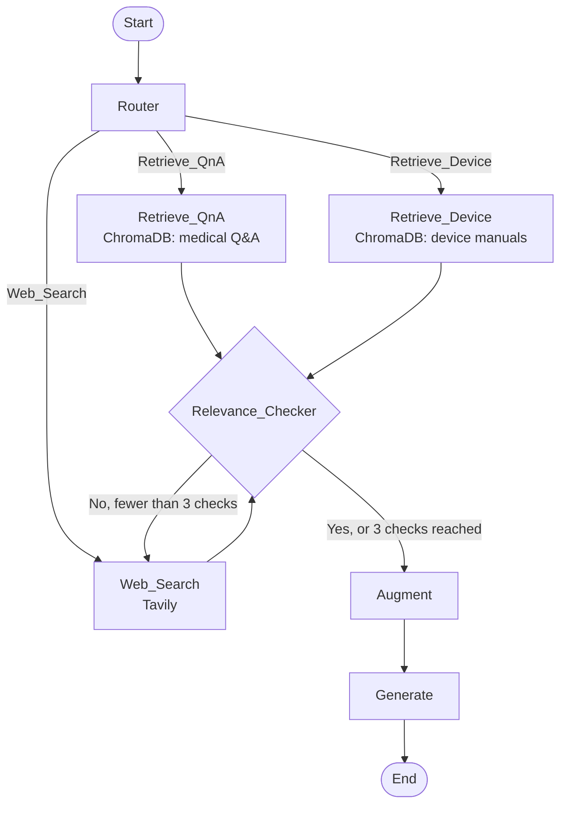

An agentic Retrieval-Augmented Generation (RAG) pipeline built with [LangGraph](https://github.com/langchain-ai/langgraph). It answers medical questions by deciding where to look for information, checking that what it found is relevant, and falling back to a live web search when the local knowledge base is not enough.

## How it works

Instead of always querying the same vector store, an LLM agent drives the workflow:

1. **Route.** An LLM reads the question and picks the most likely source:
   - `Retrieve_QnA`: general medical knowledge, symptoms, treatments
   - `Retrieve_Device`: medical devices, manuals, instructions
   - `Web_Search`: recent news, brand names, other external data
2. **Retrieve.** The top 3 matching passages are pulled from the chosen ChromaDB collection, or from the web via [Tavily](https://tavily.com).
3. **Check relevance.** An LLM judges whether the retrieved context actually answers the question (`Yes` / `No`).
   - If **No**, the agent falls back to a web search and checks again.
   - After 3 checks the agent proceeds anyway, so it can never loop forever.
4. **Augment.** The validated context and the question are combined into a final prompt.
5. **Generate.** The LLM writes a concise answer (50 words or fewer).



## Project structure

```
agentic-rag/
├── src/
│   ├── data_loader.py   # Loads the CSVs and builds the ChromaDB collections
│   ├── nodes.py         # Graph nodes: router, retrievers, web search, relevance checker, generator
│   └── graph.py         # LangGraph state, routing functions and graph wiring
├── data/                # Your CSV datasets (gitignored, see below)
├── chroma_db/           # Persistent vector store, created automatically (gitignored)
├── main.py              # Entry point (to be implemented)
├── api.py               # FastAPI web server
├── static/              # Web page (HTML, CSS, JavaScript)
├── requirements.txt
└── .env                 # API keys (gitignored)
```

## Requirements

- Python 3.9+
- An [OpenAI API key](https://platform.openai.com/api-keys)
- A [Tavily API key](https://app.tavily.com) for web search

## Installation

```bash
git clone https://github.com/dalyosint/agentic-rag.git
cd agentic-rag
python -m venv venv
source venv/bin/activate   # On Windows: venv\Scripts\activate
pip install -r requirements.txt
```

## Configuration

Create a `.env` file in the project root:

```env
OPENAI_API_KEY=sk-...
TAVILY_API_KEY=tvly-...
# Optional: the chat model to use (default: gpt-4o-mini)
LLM_MODEL=gpt-4o-mini
```

## Data

The datasets are not included in the repository. Put two CSV files in the `data/` folder:

| File | Required columns |
|------|------------------|
| `data/medical_qa.csv` | `Question`, `Answer`, `qtype` |
| `data/medical_device.csv` | `Device_Name`, `Model_Number`, `Manufacturer`, `Indications_for_Use`, `Contraindications` |

For each file, the loader takes a fixed random sample of 500 rows (`random_state=0`, so it is reproducible). It merges the columns of each row into one text field and indexes it into a persistent ChromaDB collection:

- `medical_qna`
- `medical_device_manual`

The collections are saved to `chroma_db/` and reused on later runs. To build them ahead of time:

```bash
python -m src.data_loader
```

To re-index after changing the data, call `init_collections(rebuild=True)`.

## Usage

`main.py` is still empty, so for now you can run the graph from Python. Load the environment variables first:

```python
from dotenv import load_dotenv
load_dotenv()

from src.graph import build_graph

app = build_graph()
result = app.invoke({"query": "What are the symptoms of type 2 diabetes?"})

print("Source:  ", result["source"])
print("Answer:  ", result["response"])
```

While it runs, each node prints its progress, for example:

```
---ROUTER DECISION: Retrieve_QnA---
---RETRIEVING FROM MEDICAL Q&A---
---CONTEXT RELEVANCE CHECKER---
---RELEVANCE DECISION: Yes---
---AUGMENT (BUILDING PROMPT)---
---GENERATE (CALLING LLM)---
```

### Web interface

The project also includes a chat web page, served by a FastAPI backend (`api.py` + `static/`):

```bash
uvicorn api:app --reload
```

Then open http://127.0.0.1:8000. Each answer shows which source it came from (Q&A database, device manuals or web search), with a collapsible panel holding the retrieved passages. The conversation is kept for the browser session.

API endpoints:

| Method | Path | Description |
|--------|------|-------------|
| `POST` | `/api/chat` | Body `{"query": "..."}` → `{"answer", "source", "context"}` |
| `GET` | `/api/health` | Returns `{"status": "ok"}` |
| `GET` | `/docs` | Interactive API documentation |

### Graph state

Every node reads and updates a shared `GraphState`:

| Field | Description |
|-------|-------------|
| `query` | The user's question |
| `source` | The chosen route, then the name of the source the context came from |
| `context` | Retrieved passages or web search results |
| `is_relevant` | `Yes` / `No` verdict from the relevance checker |
| `iteration_count` | Number of relevance checks performed |
| `prompt` | Final augmented prompt sent to the LLM |
| `response` | The generated answer |

## Customization

| Setting | Location | Default |
|---------|----------|---------|
| `LLM_MODEL` | `.env` / `src/nodes.py` | `gpt-4o-mini` |
| `N_RESULTS` (passages per retrieval) | `src/nodes.py` | `3` |
| `MAX_RELEVANCE_CHECKS` | `src/nodes.py` | `3` |
| `SAMPLE_SIZE` (rows indexed per dataset) | `src/data_loader.py` | `500` |

## Tech stack

- **LangGraph**: agent workflow and state management
- **ChromaDB**: local persistent vector store
- **OpenAI**: routing, relevance checking and answer generation
- **Tavily**: live web search
- **pandas**: data loading and preprocessing
- **FastAPI + Uvicorn**: web server for the chat page

## Disclaimer

This project is for educational and research purposes only. Its answers are generated by an LLM, may be inaccurate, and are **not** medical advice. Always consult a qualified healthcare professional.
